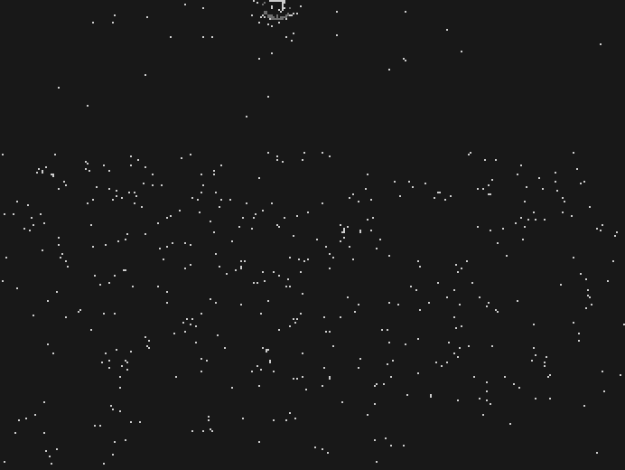

# Quick start

Run the detector on an event recording, see the result as a video, score it, and tune it. Everything here is CPU-only; a sequence of a few hundred thousand events runs in well under a second once numba has compiled.

## 1. Install

```bash
git clone https://github.com/vertov/LIBELLULA.git
cd LIBELLULA/stmd
python3 -m pip install -r requirements.txt      # numpy, numba, imageio (ffmpeg for .mp4)
python3 tests/smoke.py                          # synthetic self-test, no data needed
```

## 2. Run on one recording

With an EV-UAV file (`.npz` with a structured `ev` array; see §4 for your own data):

```bash
python3 scripts/demo.py path/to/EV-UAV/val/val_015.npz --out results/demo_val_015
```

This writes:

- `results/demo_val_015.npz` — `pred` (one bool per event: target or not), `baf`, `cand` (the stage flags), and the confirmed-track log (`trk_t_us, trk_uid, trk_x, trk_y, trk_vx, trk_vy`).
- `results/demo_val_015.mp4` and `.gif` — event frames: grey events (OFF dark, ON light, fading over 120 ms), **red** events the detector labels as target, **green** ground-truth target events where the file has labels, **yellow ring** on every confirmed-track update. Red on green is a hit; green alone is a miss; red alone is a false positive.

When the file carries labels the script also prints the EV-UAV scores (IoU, recall, precision, Pd) using a port of the dataset authors' evaluator.



## 3. Score a split

```bash
python3 scripts/eval_split.py configs/selected.json path/to/EV-UAV/val --perseq
```

prints pooled and per-sequence IoU, Pd, precision, false clusters per window, and the track-level metrics (target detection rate, window coverage, false tracks per minute; definitions in `docs/TRACK_METRICS.md`). `configs/selected.json` is the v26 segmentation point; the other operating points are `configs/v26_alarm.json` (few false tracks) and `configs/v27_segmentation_ft.json` (between the two).

The published numbers come from `scripts/final_eval_v26.py` and `scripts/final_eval_v27.py`, which score the held-out split (`splits/holdout_v26.txt`) once with bootstrap intervals. The EV-UAV `test` split was scored once, for v25, by `scripts/reproduce_v25.py`; do not tune on it.

## 4. Your own data

`demo.py` accepts any `.npz` with arrays `x`, `y`, `p` (0 = OFF/darker, 1 = ON/brighter) and either `t_us` (int64 microseconds) or `t_ms`, plus an optional `label`. Pass `--width/--height` for a sensor other than 346×260. From Python:

```python
from libstmd import model
import json
P = model.Params(**json.load(open("configs/selected.json")))
out = model.run((x, y, t_us, p), P)        # int arrays, time-sorted
out["pred"]      # bool per event
out["tracks"]    # dict of arrays: t_us, uid, x, y, vx, vy
```

The detector assumes a **fixed camera** and a quiet background. On a moving platform the activity filter and the surround inhibition see the whole scene move and the assumptions fail; there is no ego-motion compensation.

## 5. Tuning

The 45 parameters are in `libstmd/model.py` (`Params`) with one-line descriptions. The ones that move results, in rough order of effect:

| Parameter | What it does | Default (`selected.json`) | Move it when |
|---|---|---|---|
| `theta` | candidate threshold on the centre-surround score | 1.5 | too many / too few candidates on clean scenes |
| `k_inh`, `k_act` | surround inhibition weights on response / raw activity | 4 / 3 | glare edges or texture produce candidates |
| `cell`, `surround_r` | cell size (px) and ring radius (cells) | 3 / 4 | target size changes (2 px cells for very small targets) |
| `T_ba_ms`, `n_sup_hi` | activity-filter window; neighbours required when the sensor is noisy | 80 / 2 | noise level changes (`use_noise_adapt` drives this from a background-rate estimate) |
| `gate_px`, `H_min`, `T_conf_ms`, `D_min_px` | tracker gate, hits, time and displacement to confirm | 12 / 5 / 100 / 5 | false tracks (raise `H_min`, `D_min_px`) or missed targets (loosen) |
| `R_lab_px`, `T_lab_ms`, `k_vlab` | labelling radius, track age limit, velocity extension | 6 / 400 / 0 | labels too tight or too loose around the track |
| `G_rate`, `g_cell`, `tau_g_ms` | glare mute threshold (ev/px/s), region size, time constant | 1.5 / 16 / 4000 | sun or lamps in frame |
| `lab_requires_baf` | label only filter-passing events | false | precision matters more than recall |
| `use_estmd`, `w_estmd` | OFF-then-ON correlation stage and its weight | on / 0.5 | saves a third of the state when off; no measurable loss on EV-UAV |

Random search with per-sequence bookkeeping:

```bash
# 200 configurations around a base config, +-15 % of each parameter, objective = IoU + Pd
OBJECTIVE=seg python3 scripts/tune.py path/to/train:path/to/val results/search.jsonl 200 7 "$(cat configs/selected.json)" 0.15
python3 scripts/best.py results/search.jsonl | tail -1 > configs/mine.json
```

Objectives (`libstmd/pool.py`): `seg` (IoU + Pd), `seg_ft` (minus 0.01 × false tracks per minute), `alarm` (coverage + detection with a false-track budget `FT_BUDGET`). Hold out sequences you will report on with `EXCLUDE_FILE=splits/holdout_v26.txt`, and score them once at the end (`scripts/eval_split.py --only`).

## 6. The same detector in C and Verilog

```bash
cc -O2 -std=c99 -o cref/stmd_ref cref/stmd_ref.c -lm
python3 scripts/c_equivalence.py configs/selected.json path/to/EV-UAV/val     # C vs Python, per-event agreement
python3 scripts/gen_fe_vectors.py configs/selected.json ../tb/vectors/stmd_fe  # RTL parameters, tables and vectors
make -C ../sim lint-stmd-fe stmd_fe stmd_pipe                                 # Icarus replay of the Verilog, bit-exact
```

`docs/CREF.md` documents the fixed-point formats; `rtl/stmd_frontend.v` and `rtl/stmd_backend.v` are the hardware.
